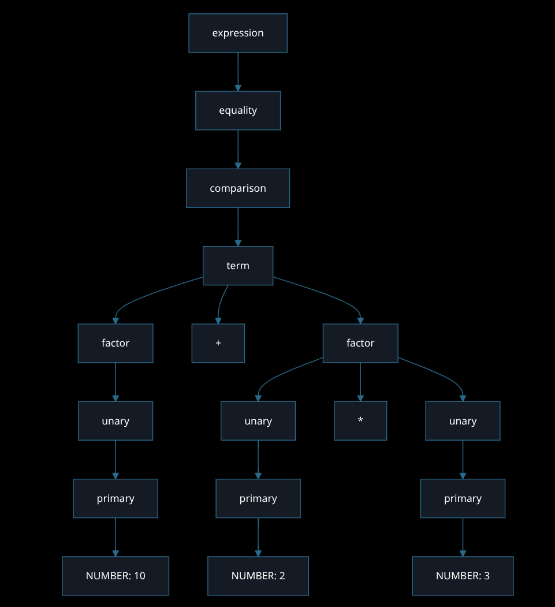

# Lab 3: Parser
Name: Korey
Language: Olympus

## What the program does

This lab adds a parser to Olympus.

The program works in three steps:
1. The scanner reads the source text and makes tokens.
2. The parser uses the tokens to build an expression tree.
3. The AST printer prints the tree.

For example, this input:

```text
10 + 2 * 3
```

prints:

```text
(+ 10.0 (* 2.0 3.0))
```

The multiplication is inside the addition because multiplication
has higher importance. The program shows the expression's
structure. It does not calculate the answer.

## Expression grammar

I kept the same expression grammar from Lab 2.

```text
expression → equality ;
equality   → comparison ( ( "!=" | "==" ) comparison )* ;
comparison → term ( ( ">" | ">=" | "<" | "<=" ) term )* ;
term       → factor ( ( "-" | "+" ) factor )* ;
factor     → unary ( ( "/" | "*" ) unary )* ;
unary      → ( "!" | "-" ) unary | primary ;
primary    → NUMBER | STRING | "true" | "false"
           | "(" expression ")" ;
```

The arrow means "can be made from."
The | symbol means "or."
The * outside quotation marks means zero or more repetitions.
Operators inside quotation marks are actual source characters.

NUMBER and STRING follow the rules from Lab 1.
The supported literal types are numbers, strings, and Booleans.

## Order

The order from highest to lowest is:

1. Unary ! and -
2. Multiplication and division
3. Addition and subtraction
4. Comparisons: <, <=, >, >=
5. Equality: == and !=

Parentheses can change the grouping.

Binary operators at the same level group from left to right.

For example:

```text
10 - 3 - 2
```

is grouped as:

```text
(10 - 3) - 2
```

The printed AST is:

```text
(- (- 10.0 3.0) 2.0)
```

Unary operators group from right to left.
For example, !!true means !(!true).

## How I built the parser

I used recursive descent, like the Lox example.
Each grammar rule has a method in the Parser class.

The methods call the next rule to read the operands.
For example, term calls factor. This lets multiplication
and division bind more tightly than addition and subtraction.

The parser builds the Literal, Unary, Binary, and Grouping
objects from Lab 2. It also checks that the whole input was
used. An input like 1 2 is rejected because 2 is left over.

## Differences from Lox

I kept Lox-style arithmetic, comparison, and equality operators.
I reused my Olympus scanner, Token class, AST classes, and printer.

Statement keywords like forge and proclaim are still
recognized by the scanner, but the parser does not accept
statements. Logical and/or operators are not included.

## Errors

The program reports lexical errors from the scanner and
syntax errors from the parser.

Syntax errors include a missing closing parenthesis,
a missing operand, an unexpected token, or extra tokens
after an expression.

Each syntax error includes the line number and the token
where the error was found. If the input ended too soon,
the message says "at end."


## How to run

I used Python 3 on Fedora KDE.
No extra packages are needed.

Run these commands from the main Olympus folder.

To read an expression from a file:

```bash
python3 src/main.py test/lab3/valid.olympus
```

To start the prompt:

```bash
python3 src/main.py
```

Enter one expression at each prompt.
Press Ctrl+D or Ctrl+C to exit.

To run the parser test script:

```bash
python3 test/lab3/test_parser.py
```

The script prints each input and its AST or error.
The results are checked manually.

To test extra tokens in a source file:

```bash
python3 src/main.py test/lab3/trailing.olympus
echo $?
```

The exit status is 0 for a successful file run and 1 for
a lexical error, syntax error, or file-reading error.

## Valid input tests

These inputs are in test/lab3/test_parser.py.
Each test checks that the parser builds the right tree.
Expected and actual output are shown below.

### Test 1: Multiplication before addition

Input: 10 + 2 * 3
Purpose: Check operator precedence.

Expected:
```text
(+ 10.0 (* 2.0 3.0))
```

Actual:
```text
(+ 10.0 (* 2.0 3.0))
```

Result: Passed.

### Test 2: Parentheses

Input: (10 + 2) * 3
Purpose: Check that parentheses change the grouping.

Expected:
```text
(* (group (+ 10.0 2.0)) 3.0)
```

Actual:
```text
(* (group (+ 10.0 2.0)) 3.0)
```

Result: Passed.

### Test 3: Subtraction order

Input: 10 - 3 - 2
Purpose: Check that subtraction groups from left to right.

Expected:
```text
(- (- 10.0 3.0) 2.0)
```

Actual:
```text
(- (- 10.0 3.0) 2.0)
```

Result: Passed.

### Test 4: Unary minus and a decimal

Input: -123 * (45.67)
Purpose: Check unary minus, a decimal number, and grouping.

Expected:
```text
(* (- 123.0) (group 45.67))
```

Actual:
```text
(* (- 123.0) (group 45.67))
```

Result: Passed.

### Test 5: Boolean values and negation

Input: !(true == false)
Purpose: Check both Boolean values, equality, and unary !.

Expected:
```text
(! (group (== true false)))
```

Actual:
```text
(! (group (== true false)))
```

Result: Passed.

### Test 6: Strings

Input: "Zeus" + " rules Olympus"
Purpose: Check string literals in a binary expression.

Expected:
```text
(+ "Zeus" " rules Olympus")
```

Actual:
```text
(+ "Zeus" " rules Olympus")
```

Result: Passed.

### Test 7: Division order

Input: 20 / 5 / 2
Purpose: Check that division groups from left to right.

Expected:
```text
(/ (/ 20.0 5.0) 2.0)
```

Actual:
```text
(/ (/ 20.0 5.0) 2.0)
```

Result: Passed.

### Test 8: Comparison before equality

Input: 1 < 2 == true
Purpose: Check that comparison binds more tightly than equality.

Expected:
```text
(== (< 1.0 2.0) true)
```

Actual:
```text
(== (< 1.0 2.0) true)
```

Result: Passed.

### Tests 9–15: More valid inputs

These tests are also in test/lab3/test_parser.py.

| Test | Purpose | Input | Expected output | Actual output | Result |
| --- | --- | --- | --- | --- | --- |
| 9 | Check nested parentheses | `((5))` | `(group (group 5.0))` | `(group (group 5.0))` | Passed |
| 10 | Check not equal | `1 != 2` | `(!= 1.0 2.0)` | `(!= 1.0 2.0)` | Passed |
| 11 | Check less than or equal | `2 <= 3` | `(<= 2.0 3.0)` | `(<= 2.0 3.0)` | Passed |
| 12 | Check greater than | `3 > 2` | `(> 3.0 2.0)` | `(> 3.0 2.0)` | Passed |
| 13 | Check greater than or equal | `3 >= 3` | `(>= 3.0 3.0)` | `(>= 3.0 3.0)` | Passed |
| 14 | Check an empty string | `""` | `""` | `""` | Passed |
| 15 | Check zero by itself | `0` | `0.0` | `0.0` | Passed |

Numbers print with .0 when they are whole numbers because
the scanner stores number values as Python floats.

## Invalid input

These inputs are in test/lab3/test_parser.py.
None of them printed an AST.

### Test 16: Missing closing parenthesis

Input: (1 + 2
Purpose: Check an unmatched opening parenthesis.
Cause: The expression ends without a closing ).

Expected:
```text
[line 1] Error at end: Expected ')' after expression.
```

Actual:
```text
[line 1] Error at end: Expected ')' after expression.
```

Result: Passed.

### Test 17: Missing right operand

Input: 1 +
Purpose: Check an operator without a right operand.
Cause: Nothing follows the +.

Expected:
```text
[line 1] Error at end: Expected expression.
```

Actual:
```text
[line 1] Error at end: Expected expression.
```

Result: Passed.

### Test 18: Operator at start

Input: * 2
Purpose: Check an unexpected operator.
Cause: * cannot start an expression in this grammar.

Expected:
```text
[line 1] Error at '*': Expected expression.
```

Actual:
```text
[line 1] Error at '*': Expected expression.
```

Result: Passed.

### Test 19: Extra token

Input: 1 2
Purpose: Check that the parser reads the whole input.
Cause: The 2 follows a complete expression without an operator.

Expected:
```text
[line 1] Error at '2': Unexpected token after expression.
```

Actual:
```text
[line 1] Error at '2': Unexpected token after expression.
```

Result: Passed.

### Test 20: Closing parenthesis

Input: 1 + )
Purpose: Check an unexpected token where an operand belongs.
Cause: A closing parenthesis cannot be the right operand of +.

Expected:
```text
[line 1] Error at ')': Expected expression.
```

Actual:
```text
[line 1] Error at ')': Expected expression.
```

Result: Passed.

### Test 21: Empty input

Input: An empty string of source text.
Purpose: Check input with no expression.
Cause: The parser reaches EOF before finding an expression.

Expected:
```text
[line 1] Error at end: Expected expression.
```

Actual:
```text
[line 1] Error at end: Expected expression.
```

Result: Passed.

### Test 22: Error on a second line

Input:
```text
1 +
)
```

Purpose: Check the line number in a syntax error.
Cause: The ) on line 2 appears where an operand is needed.

Expected:
```text
[line 2] Error at ')': Expected expression.
```

Actual:
```text
[line 2] Error at ')': Expected expression.
```

Result: Passed.

### Test 23: Invalid character

Input: 1 + @ 2
Purpose: Check that a lexical error prevents AST output.
Cause: @ is not a supported source character.

Expected:
```text
[line 1] Error: Unexpected character '@'.
```

Actual:
```text
[line 1] Error: Unexpected character '@'.
```

Result: Passed.

### Test 24: Unfinished string

Input: "Zeus
Purpose: Check an unterminated string.
Cause: The string has no closing quotation mark.

Expected:
```text
[line 1] Error: Unterminated string.
```

Actual:
```text
[line 1] Error: Unterminated string.
```

Result: Passed.

## Main program tests

### Test 25: Valid source file

Purpose: Check the scanner, parser, and printer together in file mode.

File: test/lab3/valid.olympus

Source:
```text
10 + 2 * 3
```

Command:
```bash
python3 src/main.py test/lab3/valid.olympus
```

Expected:
```text
(+ 10.0 (* 2.0 3.0))
```

Actual:
```text
(+ 10.0 (* 2.0 3.0))
```

Result: Passed.

### Test 26: Extra tokens in a source file

Purpose: Check that file mode rejects extra tokens and returns
an error exit status.

File: test/lab3/trailing.olympus

Source:
```text
1 2
```

Commands:
```bash
python3 src/main.py test/lab3/trailing.olympus
echo $?
```

Expected:
```text
[line 2] Error at '2': Unexpected token after expression.
1
```

Actual:
```text
[line 2] Error at '2': Unexpected token after expression.
1
```

Cause: The 2 is left over after the expression 1.
No AST was printed.

Result: Passed.

### Test 27: Interactive mode 

Purpose: Check that the prompt still works after syntax
and lexical errors.

Command:
```bash
python3 src/main.py
```

Inputs entered one at a time:
```text
10 + 2 * 3
1 +
1 + @ 2
1 2
"Recovered"
```

Expected output, leaving out the prompts:
```text
(+ 10.0 (* 2.0 3.0))
[line 1] Error at end: Expected expression.
[line 1] Error: Unexpected character '@'.
[line 1] Error at '2': Unexpected token after expression.
"Recovered"
```

Actual output, leaving out the prompts:
```text
(+ 10.0 (* 2.0 3.0))
[line 1] Error at end: Expected expression.
[line 1] Error: Unexpected character '@'.
[line 1] Error at '2': Unexpected token after expression.
"Recovered"
```

The errors came from a missing operand, an invalid character,
and an extra token. 

Result: Passed.

## Syntax tree example

Expression: 10 + 2 * 3

This is the syntax tree following my grammar:



The syntax tree shows how the grammar builds 10 + 2 * 3.
The AST only keeps the operators and numbers.

The program printed this AST:
```text
(+ 10.0 (* 2.0 3.0))
```

The syntax tree shows every grammar rule used.

## Limitations

The program builds and prints expression trees.
It does not calculate values or check operand types.
Variables, statements, assignment, and logical and/or
are not supported.

Each file or interactive input must contain one expression.
A semicolon after an expression is treated as an extra token.

The parser stops at the first syntax error in an input.

All documented tests passed.

## AI help

I used ChatGPT to help write and explain the parser, and test.